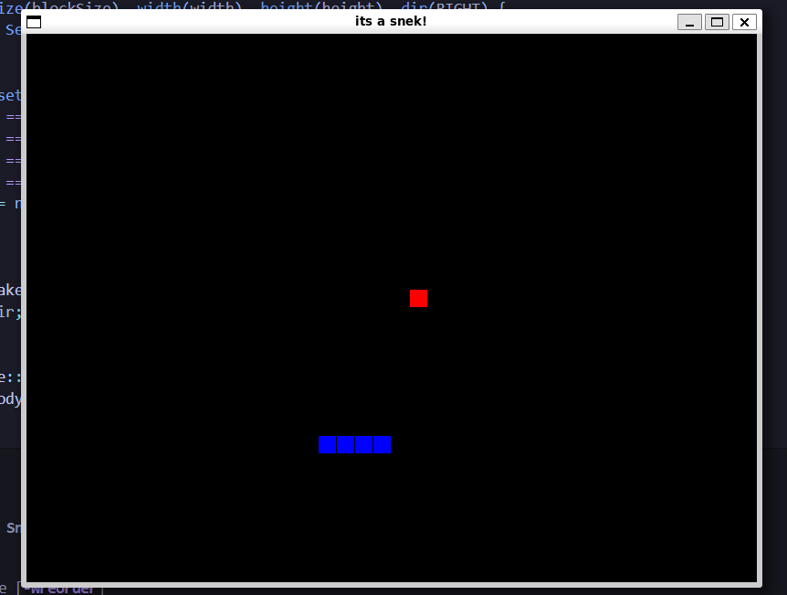
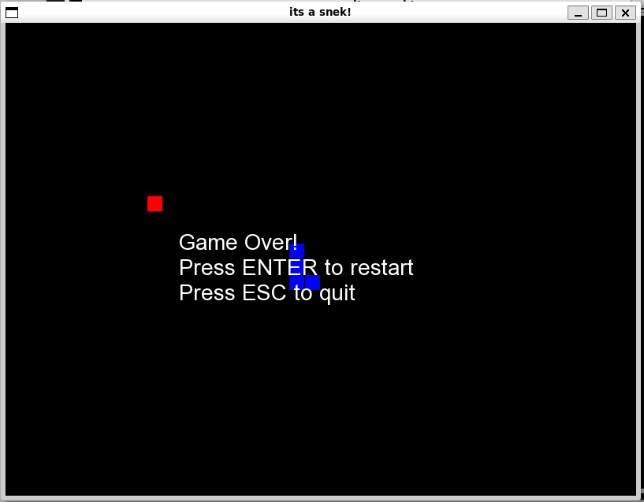

# Snek
**Snek** is a simple Snake game written in C++17 with [SFML](https://www.sfml-dev.org/). It includes an animated main menu, keyboard-controlled gameplay, food collection, growth, collision detection, and game-over/restart handling.

## Features
- 800 × 600 game window
- Animated, color-shifting title screen
- Classic Snake movement and growth
- Randomly respawning food
- Self-collision and boundary-collision detection
- Game-over screen with restart and return-to-menu options
- Bundled Arial font assets
## Requirements
- A C++17-compatible compiler
- GNU Make
- SFML 2.x development libraries:
  - `sfml-graphics`
  - `sfml-window`
  - `sfml-system`
On Debian or Ubuntu, the SFML dependency can be installed with:
```bash
sudo apt update
sudo apt install g++ make libsfml-dev
```
## Build and run
From the repository root:
```bash
make
./snake
```
The build creates object files in `obj/` and produces the `snake` executable in the repository root.
To remove generated build files:
```bash
make clean
```
## Controls
| Action | Key |
| --- | --- |
| Start the game | `Enter` |
| Move up | `Up Arrow` |
| Move down | `Down Arrow` |
| Move left | `Left Arrow` |
| Move right | `Right Arrow` |
| Restart after game over | `Enter` |
| Return to the main menu after game over | `Esc` |
| Close the game | Close the window |
## Project structure
```text
.
├── Makefile
├── src/
│   ├── main.cpp                 # Window setup and game loop
│   ├── snake.cpp                # Snake movement, growth, and collisions
│   ├── food.cpp                 # Food placement and rendering
│   ├── include/
│   │   ├── Snake.hpp
│   │   └── Food.hpp
│   ├── states/
│   │   ├── StateManager.cpp     # Active game-state management
│   │   ├── MainMenuState.cpp    # Main menu
│   │   ├── PlayingState.cpp     # Gameplay and game-over behavior
│   │   └── include/
│   ├── utils/
│   │   └── TextUtils.hpp        # Text positioning helpers
│   └── assets/
│       ├── fonts/               # Bundled font files
│       └── *.png                # Gameplay screenshots
└── obj/                         # Generated object files
```
The game uses a state-based structure. `MainMenuState` handles the title screen and transitions to `PlayingState`, while `StateManager` owns the currently active state.
## Development notes
The Makefile explicitly lists the source files and uses the following compiler settings:
```text
-std=c++17 -Wall
```
SFML libraries are linked during the final build. Run the executable from the repository root so the relative paths to the bundled font assets resolve correctly.
## Screenshots
### Gameplay

### Game over

